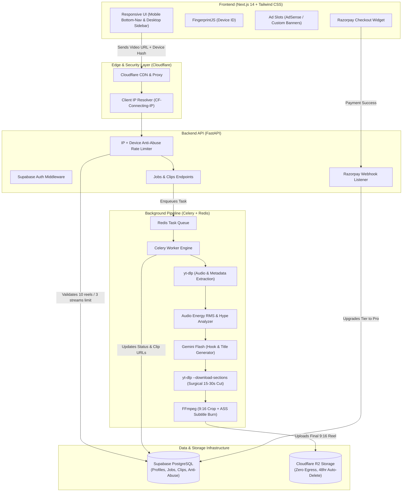

# ClipForge AI: AI Gaming Reel & Highlight Clipper SaaS 🎮🔥

A production-ready, mobile-and-desktop responsive SaaS web application built specifically for gaming content creators and reel makers. Turn massive **20 to 30-hour long gaming streams** into viral, high-action **15 to 30-second vertical (9:16) reels** with styled karaoke subtitles without downloading entire multi-gigabyte files.

---

## 📑 Architecture Overview



---

## 💰 ₹10,000 INR Total Initial Setup & Runway Budget Breakdown

This architecture is engineered to run a high-volume media processing SaaS on a shoe-string budget by eliminating egress fees, leveraging serverless free tiers, and using surgical stream downloading.

| Component | Provider & Tier | Monthly Cost (INR) | 6–8 Month Total | Why This Choice? |
| :--- | :--- | :--- | :--- | :--- |
| **Worker & API Server** | Hetzner Cloud (CPX21 - 3 vCPU, 4GB RAM) or Hostinger KVM 2 | ~₹650 – ₹850 / mo | ~₹5,100 (6 mos) | Fast CPU for FFmpeg and Celery workers, handles multiple concurrent 30s clips easily. |
| **Database & Auth** | Supabase Free Tier | ₹0 / mo | ₹0 | 500MB PostgreSQL, 50,000 Monthly Active Users, built-in Google OAuth & RLS. |
| **Object Storage** | Cloudflare R2 | ₹0 / mo (10 GB free) | ₹0 | **Zero egress fees** (unlike AWS S3 which charges \$0.09/GB). 48-hour lifecycle policy auto-deletes old clips. |
| **Caching & Queue** | Upstash Redis Free Tier or Local Redis | ₹0 / mo | ₹0 | 10,000 requests/day free on Upstash or run directly inside Docker on your VPS. |
| **Domain & DNS** | Cloudflare Registrar (.com or .in) | ~₹750 / year | ₹750 (1 yr) | Wholesale domain pricing, free SSL, DDoS protection, edge caching. |
| **AI Hook Detection** | Google Gemini 1.5 Flash API | ₹0 / mo | ₹0 | 15 RPM / 1,500 requests per day 100% free; analyzes transcripts in seconds. |
| **Payments Gateway** | Razorpay Standard | ₹0 upfront (2% per tx) | ₹0 fixed | Direct NEFT/IMPS bank settlement in India without monthly recurring platform fees. |
| **Buffer / Contingency** | VPS upgrade or Cloudflare worker | — | ~₹4,150 | Reserved for traffic spikes, proxy IP rotation if needed. |
| **TOTAL** | | **~₹850 / mo** | **~₹10,000 INR (10-12 months runway)** | |

---

## ⚡ The 20–30 Hour Long-Stream Problem & Our Surgical Solution

### The Common Failure Mode
A 20 to 30-hour gaming stream (e.g., GTA V RP, Elden Ring, Valorant tournament) is **35GB to 80GB** in file size. Traditional video clipping tools fail because:
1. Downloading 60GB over consumer or basic VPS bandwidth takes 45–90 minutes.
2. It exhausts server NVMe storage instantly.
3. Memory and CPU crash when FFmpeg attempts to decode a 30-hour timeline in one pass.

### Our Zero-Full-Download Solution
1. **Metadata & Audio Pre-Scan:**
   - Instead of downloading the video, `yt-dlp` extracts the low-bitrate opus audio stream or extracts 64kbps audio chunks (`yt-dlp -f "ba[ext=m4a]/ba"`), resulting in an audio footprint of only ~150MB for the entire stream.
2. **Audio Energy Spikes & Chat Replay Analysis:**
   - Compute Root-Mean-Square (RMS) amplitude spikes across 5-second sliding windows to pinpoint high-volume moments (shouting, excitement, high-action shootouts).
   - Correlate with YouTube chat replay message density (spikes in "LOL", "OMG", "W", "POG").
3. **Surgical Video Segment Fetching:**
   - Use `yt-dlp --download-sections "*<start>-<end>"` with YouTube's remote DASH/HLS byte-range manifests.
   - Downloads **ONLY the exact 15 to 30 seconds of high-resolution video (1080p60)** in 2–4 seconds!
4. **9:16 Vertical Reframing & Subtitle Rendering:**
   - Smart vertical crop with FFmpeg:
     - `crop=in_h*9/16:in_h:(in_w-out_w)/2:0` (Center Action Crop) or dual-layer blurred background.
   - Burn animated karaoke `.ass` subtitles with custom highlight colors directly into the video stream.
5. **Immediate S3/R2 Ingestion:**
   - Streamed to Cloudflare R2; local temporary chunks are purged immediately.

---

## 🛡️ Multi-Account Anti-Abuse (IP + Device Fingerprinting)

To prevent users from circumventing the **Free Tier cap (10 reels/day across maximum 3 long streams/day)** by creating unlimited Google accounts:

1. **Client Device Fingerprint:**
   - Generated client-side using `FingerprintJS` (hardware concurrency, canvas rendering, audio context hash, WebGL vendor).
   - Invariant even in incognito mode or across different browser tabs.
2. **Server-Side Real IP Resolution:**
   - Extracted from `CF-Connecting-IP` (when using Cloudflare) or validated `X-Forwarded-For`.
3. **Database-Level Atomic Verification (`check_and_enforce_daily_quota`):**
   - Every job creation request checks three independent dimensions for the current UTC date:
     - Count of videos/reels by `user_id`
     - Count of videos/reels by `visitor_id` (device fingerprint)
     - Count of videos/reels by `ip_address`
   - If any dimension violates the 3-video / 10-reel rule, the transaction is rejected with an HTTP 429 Too Many Requests response prompting the user to upgrade to Pro.

---

## 📁 Complete Repository Directory Structure

```text
gaming-reel-clipper/
├── .env.example                       # Complete sample configuration
├── docker-compose.yml                 # Local dev orchestration (Redis, Backend, Celery)
├── README.md                          # Architecture, budget & deployment guide
├── supabase/
│   └── schema.sql                     # PostgreSQL schema with anti-abuse procedures & RLS
├── backend/
│   ├── Dockerfile                     # Optimized Python 3.11 + FFmpeg container
│   ├── requirements.txt               # Backend and worker dependencies
│   └── app/
│       ├── __init__.py
│       ├── main.py                    # FastAPI entrypoint, CORS, rate limits
│       ├── core/
│       │   ├── config.py              # Pydantic v2 environment settings
│       │   ├── security.py            # JWT, IP validation, auth dependencies
│       │   └── supabase_client.py     # Admin Supabase client with service role
│       ├── api/
│       │   └── v1/
│       │       ├── api.py             # Root v1 router
│       │       └── endpoints/
│       │           ├── auth.py        # Token verification & session management
│       │           ├── jobs.py        # Clip generation job dispatch & status
│       │           ├── clips.py       # Retrieve clips, download counts, sharing
│       │           ├── payments.py    # Razorpay order creation & webhook listener
│       │           └── quota.py       # Check daily remaining reels & videos
│       ├── models/
│       │   └── schemas.py             # Pydantic DTOs for requests and responses
│       ├── services/
│       │   ├── yt_stream_service.py   # yt-dlp metadata, audio stream, and section cutter
│       │   ├── spike_detector.py      # Audio RMS energy & chat frequency analyzer
│       │   ├── ai_analyzer.py         # Gemini Flash hook & viral score evaluator
│       │   ├── video_editor.py        # FFmpeg 9:16 vertical crop & ASS subtitle burner
│       │   ├── r2_storage.py          # Cloudflare R2 boto3 upload & presigned URLs
│       │   └── razorpay_service.py    # Razorpay subscriptions & signature validation
│       └── workers/
│           ├── celery_app.py          # Celery configuration & Redis broker
│           └── tasks.py               # Video processing pipeline task
└── frontend/
    ├── package.json                   # Next.js 14, Tailwind, Lucide, FingerprintJS
    ├── tsconfig.json
    ├── tailwind.config.js             # Mobile & Desktop styling configurations
    ├── next.config.mjs
    └── src/
        ├── app/
        │   ├── layout.tsx             # Root layout with responsive navigation
        │   ├── page.tsx               # High-converting landing page
        │   ├── dashboard/
        │   │   ├── page.tsx           # Main workspace (Stream submit, clip library)
        │   │   └── clips/[id]/page.tsx# Single reel preview, subtitle editor & export
        │   ├── pricing/
        │   │   └── page.tsx           # Pro tier plans & Razorpay checkout modal
        │   └── api/
        │       └── webhooks/
        │           └── razorpay/route.ts # Next.js edge webhook forwarder
        ├── components/
        │   ├── dashboard/
        │   │   ├── StreamInputForm.tsx# URL input with live stream validator
        │   │   ├── JobStatusTracker.tsx # Real-time progress bar (polling/websocket)
        │   │   ├── ClipGrid.tsx       # Responsive multi-column grid of generated reels
        │   │   └── AdSlot.tsx         # Responsive Google AdSense placeholder
        │   ├── editor/
        │   │   ├── ReelPreviewer.tsx  # Mobile-sized (9:16) video player
        │   │   └── SubtitleCustomizer.tsx # Font, color & position picker
        │   └── layout/
        │       ├── MobileNavBar.tsx   # Touch-friendly bottom navigation bar
        │       ├── DesktopSidebar.tsx # Collapsible desktop sidebar
        │       └── Header.tsx         # User profile, quota badges, upgrade CTA
        ├── hooks/
        │   ├── useDeviceFingerprint.ts# React hook extracting unique browser hash
        │   └── useQuota.ts            # Live quota tracker with real-time balance
        ├── lib/
        │   ├── supabaseClient.ts      # Browser Supabase client
        │   └── utils.ts               # Formatting helpers & cn() utility
        └── types/
            └── index.ts               # Shared TypeScript interfaces
```

---

## 🚀 Quickstart Local Development Guide

### 1. Prerequisites
- Docker & Docker Compose
- Node.js 18+ & pnpm (or npm)
- Python 3.11+
- FFmpeg installed locally (`ffmpeg -version`)

### 2. Configure Environment Variables
Copy `.env.example` into `.env` at root and in both `backend/` and `frontend/`:
```bash
cp .env.example .env
cp .env.example backend/.env
cp .env.example frontend/.env.local
```
Fill in your Supabase, Cloudflare R2, Razorpay, and Gemini credentials.

### 3. Setup Supabase Database
1. Go to your Supabase SQL Editor.
2. Paste the contents of `supabase/schema.sql` and click **Run**.
3. Under Supabase Auth -> Providers, enable **Google OAuth** and set redirect URL to `http://localhost:3000/auth/callback`.

### 4. Run Backend & Celery Worker (with Docker)
```bash
# Start Redis, FastAPI backend, and Celery video worker
docker-compose up --build
```
The FastAPI backend documentation will be accessible at `http://localhost:8000/docs`.

### 5. Run Next.js Frontend
```bash
cd frontend
npm install
npm run dev
```
Open `http://localhost:3000` on your mobile browser or desktop.

---

## 🌐 Production Deployment Guide

### Option A: One-Click Render Blueprint (`render.yaml`)
1. Push this folder to a GitHub/GitLab repository.
2. In the **Render Dashboard**, click **New -> Blueprint** and select your repository.
3. Render automatically creates:
   - `clipforge-redis` (Key Value / Redis queue)
   - `clipforge-api` (FastAPI Docker web service with `/health` check)
   - `clipforge-worker` (Celery + FFmpeg + Faster-Whisper Docker worker)
   - `clipforge-frontend` (Next.js 14 Node web service)
4. Fill in the prompted environment variables (`NEXT_PUBLIC_SUPABASE_URL`, `NEXT_PUBLIC_SUPABASE_ANON_KEY`, `SUPABASE_SERVICE_ROLE_KEY`, `GEMINI_API_KEY`, and optionally R2 / Razorpay keys).
5. In Supabase **Authentication -> URL Configuration**, add `https://<your-frontend>.onrender.com/auth/callback` and `https://<your-frontend>.onrender.com/dashboard` to **Redirect URLs**.
   > **Tip (Free Tier without Worker):** If you deploy only `clipforge-api` and `clipforge-frontend` without `clipforge-worker` or Redis, set `USE_IN_PROCESS_WORKER=true` on `clipforge-api` to process jobs in-process.

### Option B: Single VPS + Serverless Frontend

1. **Frontend Deployment:**
   - Deploy `frontend/` to **Vercel** or **Cloudflare Pages** (Free Tier).
   - Set environment variables (`NEXT_PUBLIC_SUPABASE_URL`, `NEXT_PUBLIC_BACKEND_API_URL`, etc.).

2. **Backend & Worker Deployment:**
   - Provision a €5-€7/month Hetzner Cloud VPS (Ubuntu 22.04 LTS).
   - Install Docker & Docker Compose:
     ```bash
     curl -fsSL https://get.docker.com -o get-docker.sh && sh get-docker.sh
     ```
   - Clone this repository, add `.env`, and launch:
     ```bash
     docker compose -f docker-compose.prod.yml up -d
     ```
   - Configure Nginx with SSL via Certbot as a reverse proxy for `api.yourdomain.com`.

3. **Cloudflare Setup:**
   - Set Cloudflare SSL/TLS mode to **Full (Strict)**.
   - Ensure `CF-Connecting-IP` is passed to the backend headers.
   - Configure R2 bucket with 48h lifecycle expiration rule.
